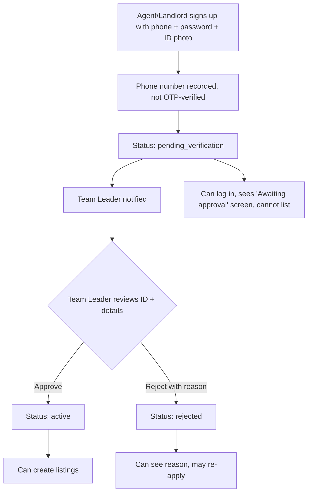

# Pilot Feature Plan: Team-Leader Approval of Agents & Landlords

## 1. Goal
During the pilot, only agents/landlords **approved by a Team Leader** can list properties. Anyone can sign up, but their account sits in a pending state until the Team Leader reviews and approves it. The Team Leader is notified of each new signup.

## 2. What the app does today (findings)

| Area | Current behaviour | Gap for this feature |
|------|-------------------|----------------------|
| Agent signup (`identity.service.ts` → `registerAgent`) | Creates user with `accountStatus: 'active'` instantly; phone OTP is mocked (`123456`) and `/verify-otp` is required | Agents are active immediately; no approval gate |
| Account status enum | `active`, `suspended`, `pending_verification` already exist (DB + `types.ts`) | `pending_verification` is unused. We can reuse it, plus add `rejected` |
| User roles | `student`, `non_student`, `agent`, `admin` | No "team leader" role. We can use `admin` (recommended) or add `team_leader` |
| `createListing` (`listing.service.ts`) | Only checks that the agent profile exists | Must also check the agent is approved |
| Auth | **No real auth.** Routes read an `x-user-id` header and fall back to a seeded agent | Approval needs at least a minimal login/role check, or anyone could approve themselves |
| Admin endpoints | None | Need approval queue, approve, reject, suspend |
| Notifications | None | Team Leader must be told of new signups |
| Frontend `/portal` | Onboarding → dashboard with no approval states | Need "pending / approved / rejected" screens and a Team Leader console |
| DB | `agent_profiles` has no review fields | Need reviewer, timestamp, rejection reason |

## 2b. Decision: OTP removed for the pilot
The Team Leader manually verifies every agent/landlord, so SMS OTP adds cost and friction without extra trust.

- **Onboarding form:** full name, phone, password, agent/landlord, ID photo (no OTP step).
- **Backend:** drop the /auth/agent/verify-otp step from the agent flow. 
egisterAgent stores the phone and a hashed password (users.password_hash already exists) and sets pending_verification. is_phone_verified is set to 	rue by the Team Leader at approval time (meaning "manually verified").
- **Login:** new POST /auth/login (phone + password) returning a JWT; GET /auth/me returns role and approval status. This replaces the x-user-id header.
- **Risk to handle:** without OTP, phone numbers aren't proven to belong to the signer. The Team Leader should call or WhatsApp the applicant before approving. Add a "Contacted / verified by phone" checkbox on the review screen.
- **Keep for later:** the OTP code can stay dormant for the post-pilot, open-signup phase.
## 3. Proposed flow

Rules:
- Pending and rejected agents **cannot create listings**. Enforced in the backend, not just hidden in the UI.
- Pending agents' listings never appear in public search (there are none, since they can't list).
- Suspending an approved agent should hide their existing listings from search.
- Every decision is written to the existing audit log (`db.recordAudit`).

## 4. Backend changes

### 4.1 Database (new Supabase migration)
- Add `rejected` to `account_status_enum`.
- Add to `agent_profiles`:
  - `approval_status` (`pending` | `approved` | `rejected`) *(or reuse `users.account_status` only, see Open Question 2)*
  - `reviewed_by UUID REFERENCES users(id)`
  - `reviewed_at TIMESTAMPTZ`
  - `rejection_reason TEXT`
  - `agent_kind` (`agent` | `landlord`), so the Team Leader can see which they are
- New table `notifications` (`id, recipient_user_id, type, payload JSONB, read_at, created_at`) for the in-app bell.
- Seed one Team Leader user (`user_type = 'admin'` or new `team_leader`).
- Keep `backend/migrations/` and `supabase/migrations/` in sync (the repo currently mirrors both).

### 4.2 Services
- `identity.service.registerAgent`: set `accountStatus: 'pending_verification'`, accept `agentKind`, create a notification for every Team Leader.
- New `approval.service.ts`:
  - `listPending()`, `getAgentForReview(id)`
  - `approve(agentProfileId, reviewerId)`
  - `reject(agentProfileId, reviewerId, reason)`
  - `suspend` / `reinstate`
  - all verify the reviewer is a Team Leader/admin
- `listing.service.createListing`: reject if the agent's user status is not `active`.
- `listing.service.search`: exclude listings whose agent is not active.

### 4.3 API
| Method | Route | Who |
|--------|-------|-----|
| `GET` | `/api/v1/auth/me` | any logged-in user (returns role + approval status) |
| `GET` | `/api/v1/admin/agents?status=pending` | Team Leader |
| `GET` | `/api/v1/admin/agents/:id` | Team Leader |
| `POST` | `/api/v1/admin/agents/:id/approve` | Team Leader |
| `POST` | `/api/v1/admin/agents/:id/reject` (`{reason}`) | Team Leader |
| `POST` | `/api/v1/admin/agents/:id/suspend` | Team Leader |
| `GET` | `/api/v1/notifications` / `POST .../:id/read` | any logged-in user |

Add a `requireRole('admin')` middleware.

### 4.4 Notifications (phased)
1. **MVP:** in-app notification bell + a "Pending approvals" badge in the Team Leader console.
2. **Next:** WhatsApp/SMS message to the Team Leader's phone ("New agent: Femi K., tap to review"), reusing the existing WhatsApp webhook infrastructure.
3. **Optional:** notify the agent on approve/reject (WhatsApp or SMS).

## 5. Frontend changes (`aroom-web`)

| Item | Detail |
|------|--------|
| Session + route guards | Store the logged-in user (id, role, approval status). Add `<RequireAuth>` / `<RequireRole>` guards. Replace the `x-user-id` fallback in `api.ts` with the real session |
| Onboarding page | Add "I am an: Agent / Landlord" choice. Remove the OTP step entirely. Add a password field. After submit, redirect to the pending screen instead of the dashboard |
| **Pending approval screen** (`/portal/pending`) | "Your application is under review. You'll be notified when approved." Shows submitted details |
| **Rejected screen** | Shows the Team Leader's reason, with "Update details & re-apply" |
| Dashboard / New Listing | Blocked unless approved; friendly message otherwise. Handle 403 from the API |
| **Team Leader console** (`/admin/approvals`) | Pending queue (name, phone, kind, ID photo, signup time). Detail drawer with ID image, Approve and Reject (reason required). Tabs: Pending / Approved / Rejected. Notification bell |
| Layouts | New `AdminLayout`, and a bell component in `AgentLayout`/`AdminLayout` |

## 6. Implementation phases

| Phase | Scope | Owner |
|-------|-------|-------|
| A | DB migration, roles, enum, seed Team Leader | Backend |
| B | `approval.service`, admin routes, `requireRole`, listing guards, tests | Backend |
| C | Session/auth guards and `/auth/me` in the frontend; pending and rejected screens | Frontend |
| D | Team Leader console (queue, detail, approve/reject) | Frontend |
| E | Notifications: in-app bell, then WhatsApp/SMS to the Team Leader | Both |
| F | QA: end-to-end test of signup → pending → approve → list; permission tests | Both |

## 7. Test checklist
- New agent signup lands in `pending_verification`; cannot create a listing (403).
- Non-admin calling `/admin/*` gets 403.
- Approve → agent can list; listing appears in search.
- Reject → reason is visible to the agent; still cannot list.
- Suspend → existing listings disappear from search.
- Team Leader receives a notification on each signup.
- Audit log has an entry for every decision.

## 8. Open questions (need your decision)

1. **Team Leader role:** reuse `admin`, or add a dedicated `team_leader` role? *(Recommendation: reuse `admin` for the pilot, since it is simpler.)*
2. **One team leader or several?** Should multiple Team Leaders see the same queue, with the first to act winning?
3. ~~Real login~~ **Decided: no OTP.** Agents and the Team Leader log in with phone number + password (JWT/session), which also replaces `x-user-id`. The Team Leader's manual review (phone call / ID check) replaces OTP as the trust step.
4. **Pre-registered agents:** the pilot starts with a known team. Should the Team Leader be able to **add/invite agents directly** (pre-approved) as well as approve self-signups?
5. **Landlord vs agent:** any difference in the required documents (e.g., proof of ownership for landlords)?
6. **Notification channel for MVP:** in-app only, or WhatsApp/SMS from day one?
7. **Re-application:** can rejected applicants resubmit, and is there a limit?
8. **Backend persistence:** the backend uses an in-memory `db/store.ts` alongside Supabase. Is the pilot going live on Supabase? Approvals must persist across restarts.

