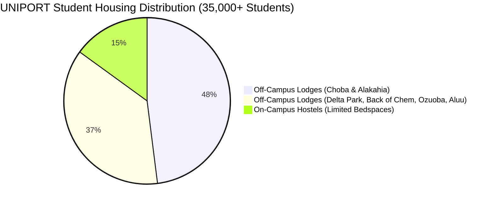
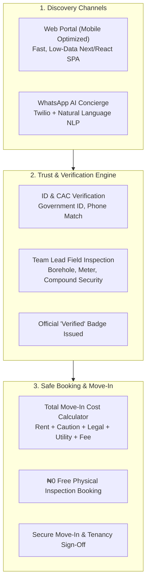
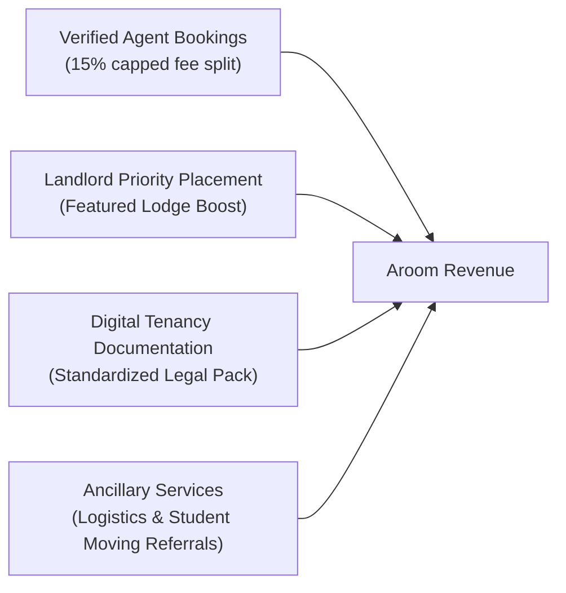
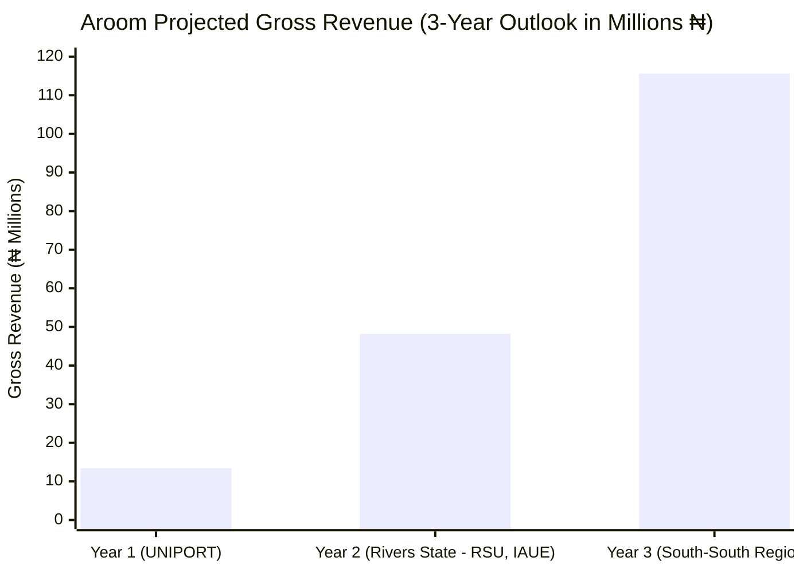
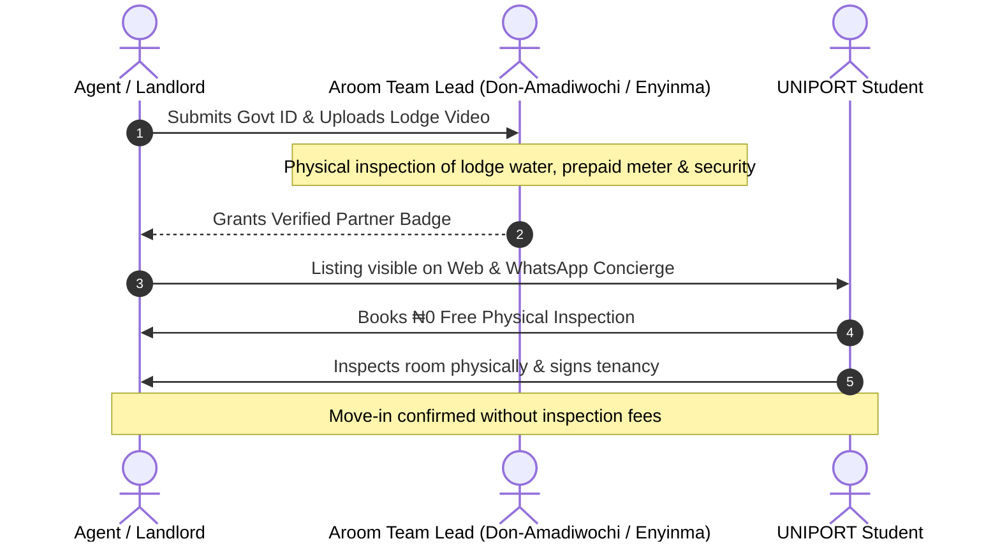

# Comprehensive Business Proposal: Aroom Technologies

**Project Name:** Aroom — Transparent Student Housing & Verified Rental Platform  
**Target Pilot Market:** University of Port Harcourt (UNIPORT), Rivers State, Nigeria  
**Prepared & Presented By:** **Don-Amadiwochi Eze** & **Enyinma Justice Smart** (Co-Founders & Operations Leads)  
**Date:** October 2026  
**Document Version:** 1.0 (Commercial & Investment Grade)  

---

## 1. Executive Summary

### 1.1 Venture Overview
**Aroom Technologies** is a specialized student accommodation platform built to eliminate the rampant extortion, fraud, and lack of transparency plaguing off-campus student housing in Nigerian tertiary institutions. Starting with an anchor launch at the **University of Port Harcourt (UNIPORT)**, Aroom combines a lightweight, mobile-first web directory, an instant zero-data **WhatsApp AI Concierge**, and a rigorous **physical verification protocol** led by the local Aroom Team Lead.

### 1.2 The Local Problem
Over **35,000 students** attend UNIPORT across its three integrated campuses (Delta Park, Abuja Campus / University Park, and Choba Park). Because institutional hostels accommodate less than 15% of the student body, over **30,000 undergraduates and medical/postgraduate scholars** must secure accommodation in neighboring communities: **Choba, Alakahia (UPTH axis), Delta Park axis, Back of Chem, Ozuoba, Aluu, and Rumuosi**.

In this off-campus ecosystem, students and their sponsoring parents face four chronic bottlenecks:
1. **The "Inspection Fee" Trap:** Roadside agents demand non-refundable fees of **₦5,000 to ₦10,000** merely to show a room. Students routinely waste **₦20,000–₦35,000** across multiple failed excursions before finding shelter.
2. **Bait-and-Switch Tactics:** Agents advertise attractive rooms online or via street fliers, only to tell exhausted students upon arrival that *"that room was just taken 20 minutes ago,"* redirecting them to substandard, overpriced lodges.
3. **Severe Hidden Move-in Price Shocks:** A room advertised at **₦220,000/year** suddenly escalates to **₦360,000+** at the point of payment through unregulated 20–25% agency fees, inflated legal documentation fees, and unannounced caretaker charges.
4. **Impersonation & Rental Fraud:** Freshers (first-year students) and parents remitting rent from distant states frequently fall prey to fraudulent "caretakers" who vanish once money is transferred.

### 1.3 The Aroom Solution
Aroom transforms this hostile journey into a transparent, secure, 4-step experience:
- **100% Free Physical Inspections (₦0 Fee Guarantee):** No student is ever charged an inspection fee or registration fee by any verified partner on Aroom.
- **Physical Team Lead Verification:** Every lodge is physically visited, water source checked (functional borehole), electricity infrastructure confirmed (prepaid meter / PHED feeder line), and agent/landlord government identity verified before receiving the green **"Verified"** trust seal.
- **Transparent Move-In Cost Calculator:** Every listing clearly breaks down Annual Rent, Caution Deposit, Legal Agreement, Utility Levy, and capped Agency Fees (15% for Verified Agents; **0% Agency Fee for Direct Landlords**).
- **Frictionless WhatsApp AI Concierge:** Students do not need high-end devices or heavy internet bandwidth; they can search, compare total costs, view video tours, and schedule physical inspections directly through an interactive WhatsApp chatbot.

### 1.4 Business & Market Opportunity
With average annual student rents at UNIPORT ranging between **₦160,000 and ₦350,000 per student**, the addressable rental turnover in the UNIPORT perimeter exceeds **₦6.5 Billion ($4.3M USD) annually**. Capturing a modest 8% transaction share in Year 1 through verified agent commissions, landlord featured placement, and digital tenancy services positions Aroom for rapid profitability and immediate scalability into other Port Harcourt institutions (Rivers State University, Ignatius Ajuru University) and federal universities across Southern Nigeria.

---

## 2. Market Analysis & Target Demographics

### 2.1 The UNIPORT Micro-Market
UNIPORT is structurally decentralized across three contiguous campuses bordered by the East-West Road:
- **Choba Campus / Choba Gate & Extension:** Highest concentration of commercial amenities, close to Sciences, Engineering, and Administration. Rent: **₦220,000 – ₦320,000/year**.
- **Alakahia & UPTH Road:** Home to the University of Port Harcourt Teaching Hospital (UPTH). Heavily populated by College of Health Sciences students, nursing scholars, and doctors needing 24-hour access and stable electricity. Rent: **₦250,000 – ₦360,000/year**.
- **Delta Park:** Primarily Humanities, Arts, and Education. Extremely tight demand near the old campus gate. Rent: **₦160,000 – ₦260,000/year**.
- **Abuja Campus / Back of Chem / University Park:** Growing cluster of modern private student lodges developed over the last 5 years. Rent: **₦200,000 – ₦300,000/year**.
- **Ozuoba, Aluu & Rumuosi:** Secondary residential clusters preferred by senior and postgraduate students seeking quieter environments or shared flat arrangements at competitive pricing (**₦180,000 – ₦280,000/year**).

### 2.2 Target Customer Personas

#### Persona A: "The Anxious Fresher & Remote Parent"
- **Profile:** 100-Level student gaining admission from Lagos, Abuja, Delta, or Imo State.
- **Pain Points:** Unfamiliar with Port Harcourt; terrified of being swindled; cannot physically visit multiple lodges before orientation week.
- **Value Received from Aroom:** Verified badges, authentic on-site video walkthroughs, zero-inspection-fee guarantee, and direct landlord contact.

#### Persona B: "The Budget-Conscious Returning Undergraduate"
- **Profile:** 200L–400L student moving out of shared quarters into an independent self-contain.
- **Pain Points:** Disgusted by wasting ₦10,000 on "mobilization fees" for dishonest street agents; frustrated by unbudgeted ₦80,000 hidden charges.
- **Value Received from Aroom:** Complete move-in cost calculator upfront; direct filtering for 0% commission landlord lodges; free physical inspection.

#### Persona C: "The Independent Private Landlord"
- **Profile:** Owns a 10–24 room student lodge in Choba or Alakahia.
- **Pain Points:** Relies on informal street agents who harass students, inflate prices, misrepresent lodge rules, and delay remittances.
- **Value Received from Aroom:** Ability to list directly with 0% fee for students, getting verified status and filling vacancies within 72 hours of semester opening.

#### Persona D: "The Professional Student Agent"
- **Profile:** Legitimate local property agent operating ethically in the university community.
- **Pain Points:** Distrusted by students due to bad actors; wastes time showing rooms to non-serious prospects.
- **Value Received from Aroom:** Official Team Lead accreditation, high-volume pre-qualified student leads delivered directly via WhatsApp.

---

## 3. Product Architecture & Competitive Advantage

### 3.1 Comparison Against Existing Alternatives

| Feature / Standard | Street / Roadside Agents | Classifieds (Jiji, Facebook Groups) | Aroom UNIPORT Platform |
| :--- | :--- | :--- | :--- |
| **Inspection Fees** | ₦5,000 – ₦10,000 per trip | Often demanded via bank transfer | **₦0. Strictly Free physical inspection.** |
| **ID & Entity Verification** | None; completely anonymous | Unregulated; frequent fake accounts | **100% verified by Aroom Team Lead.** |
| **Pricing Transparency** | Base rent quoted; huge hidden add-ons | Incomplete or misleading prices | **Exact total move-in cost itemized upfront.** |
| **Video Walkthroughs** | Rarely provided; static stolen photos | Low-quality compressed pictures | **Authentic on-site video walkthroughs.** |
| **WhatsApp Accessibility** | Random unstructured chat | Disconnected external links | **Native AI Concierge with 1-click booking.** |
| **Direct Landlord Support** | Agents block direct landlord contact | Infested with middleman impostors | **Direct Landlord listings with 0% agency fee.** |

---

## 4. Monetization & Business Model

Aroom operates a hybrid marketplace model combining transactional success commissions, landlord promotion services, and value-added student amenities.

### 4.1 Revenue Streams

1. **Transaction Facilitation Fee (Agent Marketplace Split):**
   - When a student secures a room through an accredited Aroom Verified Agent, the standard agent commission is capped at **15%** of the annual rent (preventing street gouging of 20–25%).
   - Aroom takes a **25% platform service cut** of the agent's commission for providing verified lead generation, automated inspection scheduling, and dispute mediation.
   - *Unit Math:* For an average ₦260,000 self-contain:
     - 15% Agent Commission = ₦39,000
     - Aroom Platform Share (25%) = **₦9,750 per closed lease**

2. **Landlord Featured Listing & Fast-Track Verification:**
   - Standard listing is **free** for direct property owners with **0% agency fees** charged to students.
   - Property owners with multi-unit lodges (10–30 rooms) can purchase a **"Priority Verified Boost"** (₦15,000 – ₦25,000 per semester) to guarantee top placement on both the Web directory and WhatsApp AI recommendations during peak room-hunting weeks.

3. **Standardized Tenancy Documentation & Verification Seal:**
   - Provision of tamper-proof digital tenancy contracts, inventory condition checklists, and formal rent receipts for a flat fee of **₦2,500 – ₦3,500**, eliminating arbitrary legal fees charged by rogue agents.

4. **Ancillary Partner Services (Student Move-In Logistics):**
   - Partnerships with vetted local micro-movers (minivan and tricycle operators in Choba/Alakahia) for student luggage transfers, yielding a **10% referral fee** on completed bookings.

---

## 5. Go-To-Market & Growth Strategy (UNIPORT Pilot)

Our rollout focuses on an intensive ground-up campaign designed around the university's academic calendar, specifically targetting semester resumption and fresh student clearance windows.

### 5.1 Three-Phase Execution Timeline

#### Phase 1: Supply Seeding & Physical Verification (Weeks 1 – 4)
- Deploy the Aroom Field Team across **Choba, Alakahia, Delta Park, and Back of Chem**.
- Onboard and physically inspect **50 student lodges** (representing ~300 individual bedspaces/rooms).
- Verify and accredit the initial cohort of **15 vetted campus agents** and **10 direct property owners**.
- Audit all room video tours and confirm functional borehole and prepaid electricity meters.

#### Phase 2: Campus Awareness & WhatsApp Activation (Weeks 5 – 8)
- Launch the **WhatsApp AI Concierge (`+1 415 523 8886` / local gateway)** across major UNIPORT student WhatsApp groups, faculty associations (Engineering, Medical Students Association, Management Sciences), and departmental channels.
- Deploy flyer and poster drives at high-density student transit points:
  - *Choba Gate & Choba Junction*
  - *Delta Park Bus Stop & Shuttle Terminal*
  - *UPTH Main Gate & College of Health Sciences Axis*
  - *Abuja Campus / Convocation Arena Walkway*
- Implement the **"₦0 Inspection Fee" Campaign**: Position Aroom as the student union's trusted housing watchdog.

#### Phase 3: Transaction Fulfillment & Rapid Feedback Loop (Weeks 9 – 16)
- Manage peak rental rush during orientation and new session registration.
- Maintain real-time WhatsApp Concierge support to guide students from query to physical viewing.
- Collect tenant ratings on verified agents and landlords to enforce service standards.

---

## 6. Financial Projections & Unit Economics

### 6.1 Pilot Economics (Year 1: UNIPORT Focus)
- **Target Active Off-Campus Housing Demand (UNIPORT):** 25,000 students/year
- **Year 1 Target Transaction Volume:** 1,200 successful room placements (4.8% market penetration)
- **Average Annual Rent:** ₦260,000

| Revenue Stream | Basis / Volume | Year 1 Projection (₦) | Year 1 Projection ($ USD @ ₦1,500) |
| :--- | :--- | :--- | :--- |
| **Agent Marketplace Splits** | 900 closed leases @ ₦9,750 avg | ₦8,775,000 | $5,850 |
| **Direct Landlord Priority Boosts** | 45 lodges @ ₦20,000/session | ₦900,000 | $600 |
| **Standard Tenancy Agreements** | 1,000 contracts @ ₦3,000 | ₦3,000,000 | $2,000 |
| **Logistics & Partner Referrals** | 350 moves @ ₦2,000 avg commission | ₦700,000 | $466 |
| **Gross Revenue (Year 1)** | — | **₦13,375,000** | **$8,916** |

### 6.2 3-Year Scaling Roadmap

- **Year 1 (UNIPORT Anchor):** ₦13.4M Gross Revenue (~$8.9k USD). Focus on product-market fit, zero-fraud track record, and operational mastery.
- **Year 2 (Rivers State Cluster):** Expand to Rivers State University (RSU Nkpolu/Mile 3) and Ignatius Ajuru University of Education (IAUE Rumuolumeni). 4,500 transactions; **₦48.2M Gross Revenue** (~$32.1k USD).
- **Year 3 (Regional Multi-Campus Expansion):** Roll out to Delta State University (DELSU Abraka), University of Benin (UNIBEN), and University of Calabar (UNICAL). 11,000 transactions; **₦115.6M Gross Revenue** (~$77.0k USD).

---

## 7. Operational Plan & Risk Mitigation

### 7.1 Verification & Trust Guardrails

### 7.2 Risk Assessment & Contingency Measures

| Risk Factor | Impact Level | Mitigation Strategy |
| :--- | :--- | :--- |
| **Rogue Agent Demanding Cash On-Site** | High | Zero-tolerance policy: Immediate suspension of agent badge upon first student complaint; direct reporting line to Aroom Team Lead. |
| **Landlord Renting Out Room Offline** | Medium | Reactive status toggling (`available` $\rightarrow$ `held` $\rightarrow$ `taken`) on Agent Dashboard; automated daily WhatsApp availability pings. |
| **Poor Internet Connectivity for Students** | Medium | Full functionality embedded within WhatsApp (text-only prompts, compressed video previews, lightweight web payloads). |
| **Hostel Price Inflation by Property Owners** | Low | Total Move-In Cost Calculator forces transparent disclosure of caution, legal, and utility fees, preventing surprise billings. |

---

## 8. Team & Leadership

The Aroom founding team brings together deep campus operational insight, engineering capability, and continuous on-the-ground presence at UNIPORT.

### 8.1 Leadership Biographies

- **Don-Amadiwochi Eze** — *Co-Founder & Head of Operations*
  - Leads ground operations, landlord partnership negotiations, and verification enforcement across Choba, Alakahia, and Delta Park.
  - Oversees student advocacy initiatives, direct landlord onboarding, and community relations.

- **Enyinma Justice Smart** — *Co-Founder & Head of Product & Technology*
  - Architect of the Aroom Web platform, WhatsApp AI Concierge integration, and verified listing database.
  - Manages technology partnerships (Twilio WhatsApp infrastructure, database security, and algorithmic matching).

---

## 9. The Investment & Partnership Ask

To accelerate the UNIPORT launch and secure market leadership before the upcoming academic session, Aroom is seeking:

### 9.1 Seed Funding / Grant Requirement: **₦7,500,000 ($5,000 USD)**

#### Capital Allocation:
- **40% (₦3,000,000):** Ground Verification & Field Inspection Kit (transport, on-site video equipment, lodge verification tags, local field agents).
- **25% (₦1,875,000):** Campus Student Acquisition (WhatsApp viral marketing, faculty union partnerships, campus brand ambassador stipends).
- **20% (₦1,500,000):** WhatsApp Gateway & Cloud Infrastructure (Twilio WhatsApp API credits, OpenRouter/LLM server compute, cloud database hosting).
- **15% (₦1,125,000):** Legal, Tenancy Contract Standardization & Regulatory Compliance in Rivers State.

### 9.2 Key Strategic Deliverables Supported by this Capital:
1. **150+ Verified Lodges** on-boarded and video-toured within 60 days.
2. **1,200+ UNIPORT Students** housed safely without paying a single inspection fee.
3. Over **₦12,000,000** saved for student families in avoided inspection and hidden fees.
4. Foundation laid for immediate expansion to RSU and IAUE in Year 2.

---

## 10. Conclusion & Call to Action

The student housing crisis at UNIPORT is not a problem of space alone—it is fundamentally a **crisis of trust, extortion, and information asymmetry**. 

**Aroom** solves this at the structural root:
- We remove the unfair inspection fee.
- We show every fee before a student leaves their room.
- We verify every property in person.
- We deliver the entire solution right inside the app students already use every hour: **WhatsApp**.

We invite university authorities, student union executives, property developers, and impact investors to partner with **Don-Amadiwochi Eze** and **Enyinma Justice Smart** in making UNIPORT student housing safe, dignified, and scam-free.

---
*For inquiries, partnership discussions, or pilot demonstrations:*  
**Aroom Operations Hub — UNIPORT Chapter**  
Choba & Abuja Campus Axis, Port Harcourt, Rivers State  
Email: `teamleader@aroom.ng` | Phone: `+234 809 999 0001`  
Web: [aroom.ng](http://localhost:5174/) | WhatsApp Concierge: `+1 415 523 8886`

