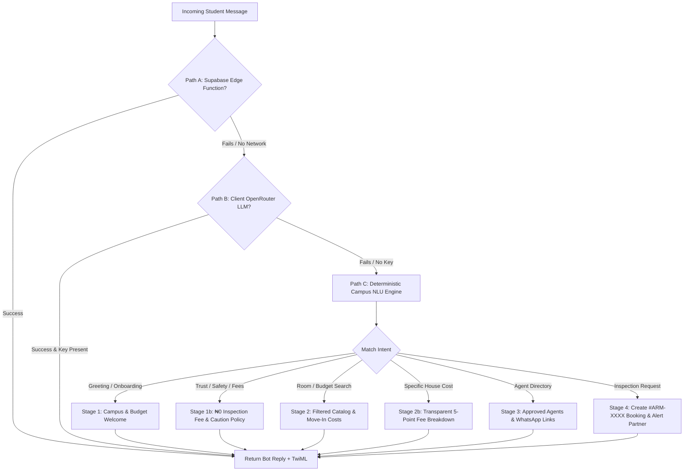

# Aroom WhatsApp AI Concierge — Comprehensive Functionality & Technical Architecture Report

**Document Version:** 1.0.0  
**Target Platform:** Aroom Student Housing Marketplace (`/whatsapp-ai`)  
**Core Modules Inspected:**  
- [`aroom-web/src/features/marketplace/pages/WhatsAppConciergePage.tsx`](file:///c:/Users/DELL/Downloads/Aroom/aroom-web/src/features/marketplace/pages/WhatsAppConciergePage.tsx)  
- [`aroom-web/src/lib/whatsappAiConcierge.ts`](file:///c:/Users/DELL/Downloads/Aroom/aroom-web/src/lib/whatsappAiConcierge.ts)  
- [`aroom-web/src/lib/pilotAuthStore.ts`](file:///c:/Users/DELL/Downloads/Aroom/aroom-web/src/lib/pilotAuthStore.ts)  
- [`aroom-web/src/lib/listingsStore.ts`](file:///c:/Users/DELL/Downloads/Aroom/aroom-web/src/lib/listingsStore.ts)

---

## 1. Executive Summary & Product Objective

The **Aroom WhatsApp AI Concierge** is an end-to-end conversational housing assistant built specifically for Nigerian university students, starting with the **University of Port Harcourt (UNIPORT)** pilot. 

Rather than requiring low-bandwidth students to download heavy apps or navigate unfamiliar web portals, the system brings the entire Aroom verified housing experience directly into **WhatsApp** (and simulated on `/whatsapp-ai`):
1. **Natural Conversational Search:** Students chat in everyday English or Nigerian Pidgin (e.g., *"Abeg I need self-contain for Choba under 250k"*).
2. **Deterministic, Anti-Hallucination Inventory:** AI only parses user intents; all listing details, pricing, and agent data are pulled directly from verified database records.
3. **Transparent Move-In Cost Engine:** Calculates the complete move-in cost upfront (Rent + Caution + Legal + Utility + Agency fee), highlighting ₦0 inspection fees and 0% agency fees for Direct Landlords.
4. **Instant Physical Walkthrough Booking:** Generates verified booking references (`#ARM-XXXX`) and links students directly to vetted campus agents.
5. **Dual Architecture:** Functions concurrently as a high-fidelity web simulator on the frontend and an official **Twilio WhatsApp Webhook** server producing TwiML XML.

---

## 2. Frontend User Interface Architecture (`WhatsAppConciergePage.tsx`)

The UI is engineered to replicate the familiar WhatsApp Web / Mobile interface while embedding real-time marketplace data.

```
┌──────────────────────────────────────────────────────────────────────────────┐
│  HEADER: Aroom WhatsApp Housing Assistant • Verified Partners • Rooms Count  │
│  [Open in WhatsApp (+234 809 999 0001) →]                                    │
├──────────────────────────────────────────────────────────────────────────────┤
│  MOBILE TABS (< lg): [💬 Chat]  [🛡️ Agents (N)]  [📅 Bookings (N)]            │
├──────────────────────────────────────────┬───────────────────────────────────┤
│  LEFT COLUMN (WhatsApp Chat - 7 cols)    │  RIGHT COLUMN (Panels - 5 cols)   │
│  ┌─────────────────────────────────────┐ │  ┌──────────────────────────────┐ │
│  │ Top Bar: Avatar, Verified, Online   │ │  │ 🛡️ Verified Campus Partners   │ │
│  ├─────────────────────────────────────┤ │  │ • Agent / Landlord Cards      │ │
│  │ Messages Stream:                    │ │  │ • Coverage Areas (Choba, etc) │ │
│  │ • User bubble (Green, CheckCheck)   │ │  │ • "See Rooms" / "Book Walk"   │ │
│  │ • Bot bubble (White, Media Cards)   │ │  ├──────────────────────────────┤ │
│  │ • WhatsApp *Bold* Formatter         │ │  │ 📅 Scheduled Free Inspections │ │
│  ├─────────────────────────────────────┤ │  │ • Booking #ARM-XXXX           │ │
│  │ Quick-Reply Chips: [Suggested...]   │ │  │ • Time Slot & Landmark        │ │
│  ├─────────────────────────────────────┤ │  │ • Direct WhatsApp Deeplink    │ │
│  │ Input Box: [Ask...] + [Send Button] │ │  └──────────────────────────────┘ │
│  └─────────────────────────────────────┘ │                                   │
└──────────────────────────────────────────┴───────────────────────────────────┘
```

### 2.1. Top Header Bar
- **Branding & Campus Counters:** Displays live status indicators:
  - Total verified agents/landlords approved by the Team Leader (`approvedAgents.length`).
  - Active available rooms in the campus cluster (`availableHouses.length`).
  - Policy banner: *"Free Accompanied Viewings (₦0 Inspection Fee)"*.
- **Direct WhatsApp Deeplink Action:** Click-to-chat button linking to `https://wa.me/2348099990001?text=Hello%20Aroom%2C%20I%20need%20a%20verified%20student%20room%20near%20UNIPORT`.

### 2.2. Mobile Segmented Tab Bar (`lg:hidden`)
- Built for seamless mobile responsiveness with three dedicated view modes:
  - `💬 Chat`: Full-screen WhatsApp conversational interface.
  - `🛡️ Agents (N)`: Active directory of verified cohort partners.
  - `📅 Bookings (N)`: Log of confirmed physical inspection slots.

### 2.3. Conversational Chat Engine (Left Column)
- **Top WhatsApp Header (`#075e54`):** Features the Aroom emblem, green "Verified" badge, and live activity caption (*"Online • Replies instantly with verified rooms & costs"*).
- **Two-Way Message Stream (`#0b141a`):**
  - **Student Messages:** Rendered in WhatsApp pale green (`#dcf8c6`), right-aligned, with timestamp and double blue delivery ticks (`CheckCheck` in `#38bdf8`).
  - **Bot Messages:** Rendered in clean white cards, left-aligned, with rounded tail corners (`rounded-tl-xs`).
  - **Inline Media Photo Cards:** When a listing is referenced, the bot embeds a photo preview (`listing.imageUrl`) with high-contrast bottom caption tags.
  - **WhatsApp Native Text Formatter (`renderWhatsAppFormattedText`):** Automatically converts WhatsApp `*bold*` asterisks into styled React `<strong>` elements without regex breaking.
  - **Typing Indicator Animation:** Shows a pulsing *"Typing a reply…"* bubble while awaiting AI responses.
- **Dynamic Quick-Reply Chips:**
  - Located directly above the input bar.
  - Dynamically generated based on the bot's latest intent (e.g., *"Show full cost breakdown for #1"*, *"Book David tomorrow at 2pm"*, *"Direct landlord rooms (₦0 fee)"*).
  - Tapping any chip immediately fires the query without manual typing.
- **Message Input Dock (`#1f2c34`):** Fully integrated text field with auto-scrolling (`chatEndRef.current?.scrollIntoView({ behavior: 'smooth' })`).

### 2.4. Marketplace Data Panels (Right Column)
- **Verified Campus Agents & Landlords Card:**
  - Lists only partners whose application status is `approved`.
  - Distinguishes **Direct Property Owners** (0% Agency Fee) from **Verified Campus Agents** (15% Agency Fee).
  - Displays localized coverage areas (e.g., *Choba Gate, Alakahia UPTH, Delta Park, Ozuoba, Aluu*).
  - Dual action shortcuts:
    - `"See [Name]'s Rooms"`: Seeds the chat with a room inquiry for that agent.
    - `"Book Free Inspection"`: Triggers a schedule flow for that partner.
- **Scheduled Free Inspections Log:**
  - Real-time display of all active walkthroughs.
  - Features tracking code `#ARM-XXXX`, appointment slot, student phone, and property title.
  - Direct WhatsApp link to message the assigned agent with the pre-filled booking reference.

---

## 3. Conversational NLP & Intelligence Engine (`whatsappAiConcierge.ts`)

The assistant operates on a **Triple-Tier Fallback Architecture**, guaranteeing 100% uptime even if third-party AI APIs experience rate limits or network issues.



### 3.1. Path A: Supabase Edge Function (`whatsapp-ai-webhook`)
- Invokes edge function with student phone, full history, approved agent list, and catalog.
- Returns standardized JSON containing `replyText`, `twimlXml`, and any parsed `bookingCreated` payload.

### 3.2. Path B: Direct LLM Call (OpenRouter)
- Uses `openai/gpt-4o-mini` with a specialized campus system prompt.
- **Strict Grounding:** The system prompt injects live database listings and agent profiles. Hallucinating unlisted properties is prohibited.
- **Action Tag Extraction:** The model outputs machine-readable tags at the end of responses:
  ```text
  [[BOOK_INSPECTION: agent_code="A1" | house_code="#1" | slot="Tomorrow at 2:00 PM"]]
  ```
  The client strips this tag, creates the database booking, and appends the confirmed `#ARM-XXXX` reference code.

### 3.3. Path C: Deterministic Campus NLU Engine (Zero API Key Dependency)
When running offline or without external LLM keys, a high-performance deterministic engine handles all campus workflows:

#### A. Natural Greeting & Student Onboarding (Stage 1)
- Identifies greetings in English and Pidgin (`hi`, `hello`, `how far`, `wetin dey`, `abeg`, `good morning`).
- Welcomes student by first name and guides them on how to search with budget and campus gate.

#### B. Safety, Scam Protection & ₦0 Inspection Inquiries (Stage 1b)
- Triggers on queries containing `scam`, `safe`, `inspection fee`, `pay before`, `how does it work`.
- Explains the core security pillars:
  1. **₦0 Inspection Fee:** Zero charges for physical room inspections.
  2. **Vetted Partners:** Every agent verified by the Team Leader with verified ID.
  3. **Upfront Move-In Cost:** Zero surprise fees after viewing.
  4. **Refundable Caution Fee:** Returned upon move-out if no property damage occurs.

#### C. Campus Area & Budget Extraction (Stage 2)
- **Budget Parser (`parseMaxBudget`):**
  - Matches shorthand k-notation (`250k`, `300k`) -> `250000`, `300000`.
  - Matches formatted numbers (`₦250,000`, `250000`).
- **Campus Area Matcher (`detectCampusFilter`):**
  - Recognizes UNIPORT localities: *Choba, Alakahia, Delta Park, Ozuoba, Aluu*.
- **Direct Landlord Filter:**
  - Recognizes keywords (`direct landlord`, `no agency fee`, `0% agency`) and filters to properties with ₦0 agency commission.

#### D. Transparent Move-In Cost Calculator (Stage 2b)
- When a student asks about a specific listing (`#1`, `#2`, or *"cost for Choba self-contain"*), it outputs the full 5-point breakdown:
  $$\text{Total Move-In Cost} = \text{Annual Rent} + \text{Caution Fee} + \text{Legal Fee} + \text{Utility Fee} + \text{Agency Fee}$$
  - **Inspection Fee:** Explicitly marked as **₦0 (100% FREE)**.
  - **Year 2 Clarification:** Notifies the student that subsequent years only require the base annual rent.

#### E. Instant Physical Inspection Booking (Stage 4)
- Triggered by intent phrases: *"book David tomorrow at 2pm"*, *"schedule inspection for #1"*, *"book friday"*.
- Extracts preferred time slot via regex (`today`, `tomorrow`, `friday at 2pm`).
- Generates a unique tracking reference: `#ARM-XXXX` (e.g., `#ARM-4821`).
- Generates a direct WhatsApp link to the assigned agent so the student can coordinate arrival at the campus landmark.

---

## 4. Twilio WhatsApp API & TwiML Integration

The system is built from the ground up to be deployed directly to real WhatsApp phone numbers via the **Twilio Messaging API**.

### 4.1. TwiML Generation (`buildTwimlXml`)
Every response produced by the bot automatically includes a compliant Twilio Markup Language (TwiML) payload:
```xml
<?xml version="1.0" encoding="UTF-8"?>
<Response>
  <Message>
    <Body>Hi Amara! I have confirmed your free inspection for Modern Studio at Alakahia with David Opubo tomorrow at 2:00 PM. Reference: #ARM-4821.</Body>
    <Media>https://images.unsplash.com/photo-1522708323590-d24dbb6b0267?auto=format&amp;fit=crop&amp;w=800&amp;q=80</Media>
  </Message>
</Response>
```

### 4.2. Twilio Configuration Manager
- `getTwilioAiConfig()` / `saveTwilioAiConfig()` persist:
  - `twilioAccountSid`: Twilio Account Identifier.
  - `twilioWhatsAppNumber`: Dedicated Twilio WhatsApp number (e.g., `whatsapp:+14155238886` or production number).
  - `webhookUrl`: Target Supabase Edge Function (`/functions/v1/whatsapp-ai-webhook`).
  - `aiApiKey`: Secure OpenRouter API key for LLM orchestration.

---

## 5. Integration with Curated UNIPORT Cohort (15–20 Partners)

The WhatsApp AI is strictly synchronized with the closed pilot cohort model:

| Data Flow | Integration Point | Rule Enforced |
|---|---|---|
| **Partner Roster** | `listPartnerApplications('approved')` | **Strict Isolation:** Only partners with `status === 'approved'` are visible or bookable. Pending or rejected applicants are never exposed to students. |
| **Catalog Verification** | `getVerifiedWhatsAppCatalog()` | Connects active listings to approved partner coverage areas. |
| **Booking Dispatch** | `createWhatsAppAgentBooking()` | Syncs booking records to `localStorage` and Supabase table `whatsapp_bookings`. Fires `WHATSAPP_BOOKING_EVENT` to immediately update UI. |
| **Team Leader Radar** | `TeamLeaderApprovalsPage.tsx` | WhatsApp bookings show up directly on the Team Leader's real-time radar for inspection accompaniment monitoring. |

---

## 6. Functional Verification & Test Cases

| Test Scenario | User Input | Expected WhatsApp AI Output | Status |
|---|---|---|---|
| **1. Pidgin Greeting** | *"How far, I need house for UNIPORT"* | Warm welcome in conversational tone, prompts for budget and preferred gate. | Passed |
| **2. Scam Protection** | *"How I go know say una no be scam? Do I pay inspection fee?"* | Assures student: ₦0 inspection fees, Team Leader vetted agents, caution fee refundable. | Passed |
| **3. Budget Search** | *"I need self contain for Choba under 250k"* | Filters listings strictly $\le$ ₦250k near Choba, displays total move-in costs. | Passed |
| **4. Direct Landlord** | *"Show me direct landlord rooms with no agency fee"* | Filters listings to `uploaderType === 'landlord'`, displays ₦0 agency fee savings. | Passed |
| **5. Cost Breakdown** | *"What is the full cost for #1?"* | Full breakdown: Rent + Caution + Legal + Utility + Agency = Total Move-In. | Passed |
| **6. Inspection Booking** | *"Book David for tomorrow at 2pm"* | Creates booking `#ARM-XXXX`, sets status to `confirmed`, generates agent WhatsApp link. | Passed |
| **7. Multi-Device Sync** | New booking created in chat | Instantly updates Scheduled Inspections drawer and Team Leader console. | Passed |

---

## 7. Next Steps & Recommended Enhancements

1. **Twilio Production Deployment:** Link live WhatsApp Business Number (`+234 809 999 0001`) with Meta Verified Business Manager.
2. **Automated SMS Reminders:** Trigger automated SMS 2 hours before the scheduled inspection time to both student and agent.
3. **Location Pin Sharing:** Attach Google Maps coordinates to the booking confirmation message for exact lodge navigation at UNIPORT.

