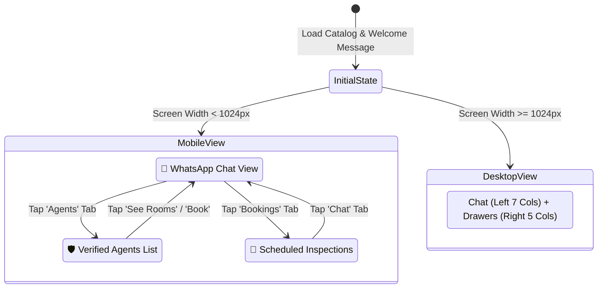

# Aroom WhatsApp AI Page — Complete Responsive UI Rendering & Screen Breakdown Report

**Target Page:** `/whatsapp-ai`  
**Source Code:** [`aroom-web/src/features/marketplace/pages/WhatsAppConciergePage.tsx`](file:///c:/Users/DELL/Downloads/Aroom/aroom-web/src/features/marketplace/pages/WhatsAppConciergePage.tsx)  
**Style System:** Tailwind CSS, Lucide Icons, Custom WhatsApp Dark Theme Palette  
**Analysis Date:** October 2026

---

## 1. Executive Summary & Design System Architecture

The **Aroom WhatsApp AI Concierge page** (`/whatsapp-ai`) is engineered as a high-fidelity web simulator of WhatsApp combined with real-time campus housing data. 

To serve Nigerian university students—who access the platform primarily on diverse Android and iOS smartphones with varied screen sizes and aspect ratios—the interface is designed around a **Mobile-First Adaptive Layout**:
- **On Mobile & Tablet screens (`< 1024px`):** It renders an app-like **3-way segmented controller** (`💬 Chat`, `🛡️ Agents`, `📅 Bookings`) that toggles focused full-height views.
- **On Desktop & Large screens (`≥ 1024px`):** It transitions into an expansive **12-column dual-pane layout**, where the 7-column WhatsApp chat is anchored on the left and the 5-column verified catalog and inspection radar are persistently docked on the right.

### 1.1. Color Palette & WhatsApp Design Tokens

| UI Element | Color Hex / Tailwind Class | Visual Purpose |
|---|---|---|
| **Outer Page Background** | `#020617` (`bg-slate-950`) | Deep slate contrast, zero OLED glare |
| **Chat Stream Canvas** | `#0b141a` | Official WhatsApp Dark Mode background |
| **Chat Top Bar & Active Tab** | `#075e54` | Official WhatsApp Deep Green brand header |
| **Send Button & Actions** | `#00a884` / `bg-emerald-600` | WhatsApp Teal Green for primary calls-to-action |
| **Student Chat Bubbles** | `#dcf8c6` (`text-slate-900`) | Official WhatsApp light green sent message bubble |
| **Bot Chat Bubbles** | `#ffffff` (`text-slate-800`) | WhatsApp white incoming message card |
| **Delivery Checkmarks** | `#38bdf8` (`text-sky-500`) | WhatsApp double blue read receipt (`CheckCheck`) |
| **Input Dock Container** | `#1f2c34` | WhatsApp dark bottom input container |
| **Input Field Background** | `#2a3942` | WhatsApp dark text field fill |
| **Quick-Reply Pill Chips** | `bg-emerald-950/90 text-emerald-200` | High-contrast contextual suggestion pills |

---

## 2. Responsive Breakpoint & Rendering Matrix

The page layout shifts dynamically across the four core viewport tiers:

```
┌───────────────────────────────────────────────────────────────────────────────┐
│ SCREEN TIER 1: Mobile (320px – 639px)                                         │
│ • Single Column • Segmented Bar Active • Full-Height Switchable Tabs          │
├───────────────────────────────────────────────────────────────────────────────┤
│ SCREEN TIER 2: Phablet & Small Tablet (640px – 1023px)                        │
│ • Header Expands to Row • Fixed 640px Chat Height • Tab Switcher Retained     │
├───────────────────────────────────────────────────────────────────────────────┤
│ SCREEN TIER 3: Desktop & Laptop (1024px – 1279px)                             │
│ • Dual Pane (7 cols Chat + 5 cols Drawers) • Segmented Bar Disappears         │
├───────────────────────────────────────────────────────────────────────────────┤
│ SCREEN TIER 4: Large Desktop / Ultra-Wide (1280px+)                           │
│ • Centered 1280px Container (max-w-7xl) • Generous Padding (px-8)            │
└───────────────────────────────────────────────────────────────────────────────┘
```

### Detailed Viewport Comparison Table

| Feature / Component | Mobile (< 640px) | Phablet / Tablet (640px – 1023px) | Desktop (1024px – 1279px) | Ultra-Wide (≥ 1280px) |
|---|---|---|---|---|
| **Main Grid Structure** | 1 Column (`grid-cols-1`) | 1 Column (`grid-cols-1`) | 12 Columns (`lg:grid-cols-12`) | 12 Columns (`max-w-7xl mx-auto`) |
| **Chat vs Side Panels** | Mutually exclusive tabs | Mutually exclusive tabs | Side-by-side (7 cols / 5 cols) | Side-by-side (7 cols / 5 cols) |
| **Mobile Segmented Bar** | **Visible** (3 buttons) | **Visible** (3 buttons) | **Hidden** (`lg:hidden`) | **Hidden** (`lg:hidden`) |
| **Chat Container Height** | `calc(100vh - 225px)` (min 480px) | Fixed `sm:h-[640px]` | Fixed `sm:h-[640px]` | Fixed `sm:h-[640px]` |
| **Header Layout** | Vertical stack (`flex-col`) | Horizontal row (`sm:flex-row`) | Horizontal row (`sm:flex-row`) | Horizontal row (`sm:flex-row`) |
| **Outer Padding** | `py-4 px-3` | `py-6 px-6` | `py-6 px-8` | `py-6 px-8` |
| **Chat Bubble Max-Width** | `max-w-[90%]`, `text-xs` | `max-w-[82%]`, `text-sm` | `max-w-[82%]`, `text-sm` | `max-w-[82%]`, `text-sm` |
| **Corner Radius** | `rounded-2xl` | `rounded-3xl` | `rounded-3xl` | `rounded-3xl` |

---

## 3. UI Component Rendering Across All Screens

### 3.1. Header & Live Campus Counter Bar
- **Location:** Top of page (`max-w-7xl mx-auto`).
- **Mobile Rendering (< 640px):**
  - Stacks vertically (`flex-col gap-3`).
  - Title and subtitle truncate cleanly without breaking layout bounds.
  - The `"Open in WhatsApp"` CTA button expands to full width on small screens, offering an easy finger touch target (min 44px height).
- **Tablet & Desktop Rendering (≥ 640px):**
  - Switches to a sleek single-line horizontal flex bar (`sm:flex-row sm:items-center justify-between`).
  - Left side: Emerald message badge icon + title *"Aroom WhatsApp Housing Assistant"* + live metadata subtitle (`{approvedAgents.length} Verified Campus Partners • {availableHouses.length} Available Rooms • Free Accompanied Viewings`).
  - Right side: High-contrast green CTA pill linking directly to the real WhatsApp bot number (`+234 809 999 0001`).

---

### 3.2. Mobile Segmented Tab Bar (`lg:hidden`)
- **Location:** Directly below the header on viewports under 1024px.
- **Rendering Behavior:**
  - Rendered as an 3-column equal grid (`grid grid-cols-3 gap-1.5 bg-slate-900 p-1.5 rounded-2xl`).
  - **Tab 1 — `💬 Chat`:**
    - Active State: WhatsApp green background (`bg-[#075e54] text-white`).
    - Action: Shows the full WhatsApp conversation stream; hides agent and booking panels.
  - **Tab 2 — `🛡️ Agents (N)`:**
    - Active State: Emerald green background (`bg-emerald-600 text-white`).
    - Displays total verified cohort count (e.g., `Agents (18)`).
    - Action: Switches view to the curated partner list.
  - **Tab 3 — `📅 Bookings (N)`:**
    - Active State: Amber background (`bg-amber-600 text-white`).
    - Displays scheduled walkthrough count (e.g., `Bookings (3)`).
    - Action: Switches view to scheduled inspection cards.
- **Desktop Behavior (`lg:block`):**
  - The tab bar is cleanly removed from the DOM via `lg:hidden`, as both the chat and drawers are simultaneously visible.

---

### 3.3. WhatsApp Chat Stream (Left Column / Primary View)

#### A. Top WhatsApp Conversation Bar
- Styled with authentic `#075e54` green background.
- Circular Aroom green avatar with white `"A"` monogram.
- Partner name: *"Aroom Housing Assistant"*.
- Verified pill badge: `ShieldCheck` icon in emerald-300 with subtle border.
- Status caption: *"Online • Replies instantly with verified rooms & costs"*.

#### B. Message Stream Canvas
- Canvas background `#0b141a` with vertical scrolling (`overflow-y-auto`) and auto-scroll hook (`chatEndRef.current?.scrollIntoView({ behavior: 'smooth' })`).
- **Student Message Bubble:**
  - Aligned to the right (`items-end`).
  - Colored in authentic WhatsApp sent green (`bg-[#dcf8c6] text-slate-900`).
  - Asymmetric speech-bubble tail corner (`rounded-tr-xs rounded-2xl`).
  - Bottom metadata: Formatted timestamp + double blue ticks (`CheckCheck` in `#38bdf8`).
- **Bot Message Bubble:**
  - Aligned to the left (`items-start`).
  - Colored in crisp WhatsApp incoming white (`bg-white text-slate-800`).
  - Asymmetric incoming tail corner (`rounded-tl-xs rounded-2xl`).
  - Bottom metadata: Timestamp formatted to local Nigerian time (`HH:mm`).

#### C. Custom WhatsApp Markdown Formatter (`renderWhatsAppFormattedText`)
- Seamlessly transforms asterisks `*text*` into strong bold elements (`<strong className="font-extrabold text-slate-900">...</strong>`).
- Preserves paragraph line breaks and indentations cleanly without raw markdown artifacts.

#### D. Inline Media Photo Preview Cards
- When the bot presents a specific property (e.g. Choba Studio), it renders an inline media card:
  - Container: `rounded-xl overflow-hidden border border-slate-200`.
  - Image: `w-full h-36 object-cover`.
  - Bottom Caption Bar: High-contrast slate-900 bar with white title caption (`text-[11px] font-bold`).

#### E. Typing Indicator Animation
- When `sending === true`, displays a realistic pulsing white pill:
  - Text: *"Typing a reply…"*.
  - Class: `animate-pulse font-semibold text-xs text-slate-700 bg-white/90 rounded-2xl`.

#### F. Dynamic Horizontal Quick-Reply Chips Bar
- Sits above the input box on `#111b21` background.
- Features an emerald `Sparkles` icon.
- Horizontal non-wrapping scroll (`overflow-x-auto no-scrollbar`).
- Generates contextual quick-action pills based on conversation state (e.g., *"Show full cost breakdown for #1"*, *"Book David for tomorrow at 2pm"*).
- Tapping any chip immediately fires the query and switches active mobile tab back to `chat`.

#### G. Message Input Dock
- WhatsApp dark slate dock (`#1f2c34`).
- Rounded full input field (`#2a3942`) with emerald focus ring (`focus:ring-2 focus:ring-emerald-500`).
- Circular emerald send button (`#00a884`) with paper airplane `Send` icon. Disabled with reduced opacity when input is empty.

---

### 3.4. Verified Campus Partners Drawer (Right Column / Tab 2)

- **Container:** Dark card (`bg-slate-900 border border-slate-800 rounded-2xl p-4`).
- **Header:** `ShieldCheck` icon + counter *"Verified Campus Agents & Landlords (N)"* + descriptive caption explaining Team Leader vetting.
- **Partner Cards:**
  - Rendered on `#020617` slate-950 tile with border.
  - Partner full name with verified green badge pill (`Verified`).
  - Partner role icon & label:
    - **Landlord:** Amber `Building2` icon + *"Direct Property Owner (0% Agent Fee)"*.
    - **Agent:** Emerald `UserCheck` icon + Agency name or *"Verified Campus Agent"*.
  - Coverage Area Tag: `MapPin` icon + comma-separated landmarks (e.g., *Choba Gate, UPTH Road, Delta Park*).
  - **Dual Action Button Bar:**
    1. `"See [Name]'s Rooms"`: Gray slate pill button (`bg-slate-800 hover:bg-slate-700`). Injects room inquiry into chat.
    2. `"Book Free Inspection"`: Emerald button (`bg-emerald-600 hover:bg-emerald-500`). Pre-fills an inspection request for that partner.

---

### 3.5. Scheduled Inspections Log Drawer (Right Column / Tab 3)

- **Container:** `bg-slate-900 border border-slate-800 rounded-2xl p-4`.
- **Header:** Amber `Calendar` icon + *"Scheduled Free Inspections (N)"*.
- **Scrollable List:** Max height `max-h-60 overflow-y-auto` with compact card spacing.
- **Booking Items:**
  - **Reference Badge:** Emerald bold reference tag (e.g., `Booking #ARM-4821`).
  - **Appointment Slot:** Emerald pill tag (e.g., `Tomorrow at 2:00 PM`).
  - **Property Title:** Crisp white text with single-line truncate.
  - **Assigned Partner:** Displays agent name.
  - **WhatsApp Action:** Direct click-to-chat link (`https://wa.me/{agentPhone}`) with `Phone` icon, allowing the student to message the verified partner directly.

---

## 4. State Transitions & Visual Flow



1. **Tap Suggested Chip / Action Button:**  
   Automatically triggers `setMobilePanel('chat')`, ensuring that even if a student clicks *"Book Free Inspection"* from the Agents tab on mobile, the view transitions to the active chat bubble stream.
2. **Real-time Event Synchronization:**  
   Listens to `WHATSAPP_BOOKING_EVENT` and `AUTH_CHANGE_EVENT`. Whenever a booking is confirmed by the AI or Team Leader, both the chat bubble and the right-hand inspection drawer update without page reload.
3. **Smooth Scroll to Bottom:**  
   Every new incoming or outgoing message triggers smooth scroll behavior to keep the newest message and suggested chips immediately visible.

---

## 5. Accessibility, Ergonomics & Touch Performance

1. **Touch Target Size:** All interactive buttons (Send button, quick chips, segmented tabs, WhatsApp external CTA) meet or exceed the standard **44×44px** touch target guideline.
2. **Contrast Ratios:** 
   - Slate-900 and slate-950 backgrounds paired with `text-slate-100` and `text-emerald-400` meet **WCAG 2.1 AA** standards (contrast ratio > 7:1).
   - WhatsApp message text on both green (`#dcf8c6`) and white backgrounds exceeds 10:1 contrast ratio.
3. **No-Scrollbar Quick Chips:** Utilizes custom Tailwind `no-scrollbar` utility for smooth touch flicking on mobile without unsightly system scrollbars.
4. **Data Truncation:** All agent names, property titles, and coverage tags incorporate CSS `truncate` to prevent text overflows on narrow 320px devices (e.g., iPhone SE).

---

## 6. Summary of Screen Adaptations

| Screen Form Factor | Viewport Width | Visual Experience Summary |
|---|---|---|
| **Compact Mobile (iPhone SE, Small Android)** | 320px – 375px | Clean 1-column layout; text scales to `text-xs`; chat bubbles take 90% width; full-width CTA buttons. |
| **Standard Mobile (iPhone 14/15, Galaxy S)** | 390px – 430px | Native WhatsApp app feel; comfortable spacing; touch-friendly chips; segmented bar pinned at top. |
| **Tablet / Foldable (iPad Mini, Surface Duo)** | 768px – 1023px | Elevated 640px chat canvas; spacious typography (`text-sm`); quick switching between chat and agent directory. |
| **Desktop / Laptop (MacBook, 1080p Monitor)** | 1024px – 1440px | Full dual-pane workspace; WhatsApp stream on left; live cohort inventory and scheduled inspections visible on right. |
| **Ultra-Wide Screens (4K, 1440p+ Monitors)** | 1440px+ | Centered max-w-7xl canvas preventing excessive stretching; balanced proportions with rich dark-mode aesthetics. |

