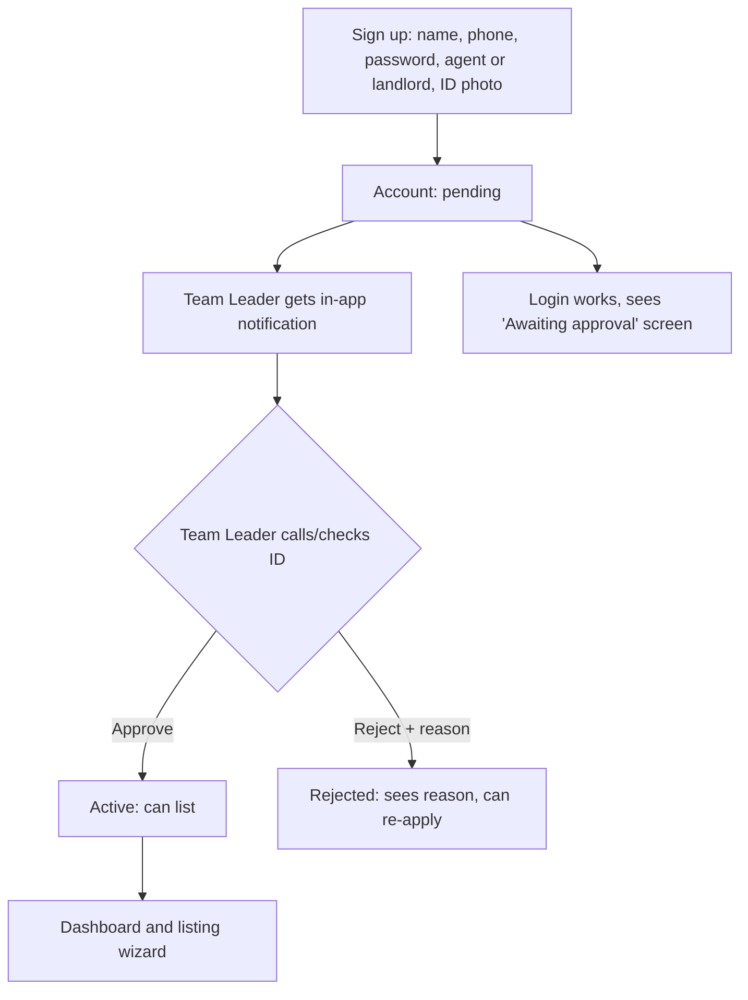

# MVP Plan: Authentication, Onboarding & Agent Approval

Scope: the **pilot MVP** only. Builds on [Agent_Approval_Feature_Plan.md](Agent_Approval_Feature_Plan.md). Anything not listed here is deferred (see section 9).

> Items marked **(assumed)** are defaults I chose so planning can move forward. Change them if you disagree.

## 1. MVP goals
1. Only Team-Leader-approved agents/landlords can list properties.
2. Tenants and students can browse and reach an agent with the least friction possible.
3. No OTP/SMS cost or dependency in the pilot.
4. Design so that adding OTP and Supabase Auth later is a swap, not a rewrite.

## 2. Users and what each can do in the MVP

| User | Account? | Auth method | Can do |
|------|----------|-------------|--------|
| Tenant / student | **Not required to browse.** Light "contact details" capture at the moment of booking an inspection **(assumed)** | None (name + phone captured per inquiry) | Search, view listings, request an inspection |
| Agent / landlord | Yes | Phone + password | Sign up, wait for approval, then list and manage listings |
| Team Leader | Yes (seeded) | Phone + password | Review queue, approve/reject/suspend, add agents directly |

Tenants and students have **no login in the MVP**. That removes the biggest friction point, and the real student auth (OTP, campus verification) comes after the pilot.

## 3. Agent/landlord journey

Team Leader can also **add an agent directly** (pre-approved) for the known starting team **(assumed)**.

## 4. Backend work

### 4.1 Database (one Supabase migration, mirrored in `backend/migrations/`)
- `account_status_enum`: add `rejected`.
- `agent_profiles`: add `agent_kind` (`agent`|`landlord`), `reviewed_by`, `reviewed_at`, `rejection_reason`, `phone_contacted` (boolean).
- `users.password_hash`: already exists. Use it (bcrypt/argon2).
- New table `notifications` (`id, recipient_user_id, type, payload, read_at, created_at`).
- Seed: one Team Leader user with `user_type = 'admin'` **(assumed: reuse `admin`)**.

### 4.2 Services and endpoints

| Endpoint | Access | Purpose |
|----------|--------|---------|
| `POST /auth/agent/signup` | public | Create user (`pending_verification`), hash password, notify Team Leader |
| `POST /auth/login` | public | Phone + password, returns JWT |
| `GET /auth/me` | logged in | Role and approval status |
| `GET /admin/agents?status=` | admin | Queue |
| `GET /admin/agents/:id` | admin | Detail with ID image |
| `POST /admin/agents` | admin | Add pre-approved agent |
| `POST /admin/agents/:id/approve` | admin | Set `active`, record reviewer |
| `POST /admin/agents/:id/reject` | admin | Reason required |
| `POST /admin/agents/:id/suspend` | admin | Hide their listings |
| `GET /notifications`, `POST /notifications/:id/read` | logged in | In-app bell |

Guards:
- `requireAuth` and `requireRole('admin')` middleware. **Remove the `x-user-id` fallback.**
- `createListing` rejects agents whose status is not `active` (403).
- `search` excludes listings of non-active agents.
- Every decision calls `db.recordAudit`.

### 4.3 Inquiry without account
- Inquiry accepts `{ name, phone, listingId, preferredTime }` from the visitor. This needs a backend check: the current inquiry route may expect an existing student user, so confirm and adapt it.
- Rate-limit the endpoint (per IP and per phone) to reduce spam, since there's no OTP.

## 5. Frontend work (`aroom-web`)

| Item | Detail |
|------|--------|
| `AuthProvider` / `useAuth()` | Holds token, user, role, status; persists in `localStorage` |
| `api.ts` | Attach `Authorization: Bearer <token>`; remove any `x-user-id` use; handle 401/403 globally |
| Guards | `RequireAuth`, `RequireRole`, `RequireApproved` |
| `/portal/signup` | Replaces the current onboarding: add password and agent/landlord choice, remove the OTP step |
| `/portal/login` | Phone + password |
| `/portal/pending`, `/portal/rejected` | Status screens (rejected shows the reason and a re-apply link) |
| Dashboard, New Listing | Behind `RequireApproved`; friendly message on 403 |
| `/admin/login` (or shared login) and `/admin/approvals` | Queue with tabs (Pending/Approved/Rejected), detail drawer with ID photo, "I contacted them" checkbox, Approve / Reject (reason) |
| Notification bell | In the admin header (polling every 30 s is fine for MVP) |
| Inquiry form | Name + phone modal on the listing detail page |

## 6. Delivery phases

| Phase | Work | Owner | Done when |
|-------|------|-------|-----------|
| 1 | Migration, seed Team Leader, password hashing, `/auth/login`, `/auth/me`, `requireAuth/Role` | Backend | Can log in as the seeded Team Leader and get a JWT |
| 2 | Signup change, `approval.service`, admin endpoints, listing guards, notifications table and endpoints, tests | Backend | Pending agent gets 403 on listing; approve fixes it |
| 3 | `AuthProvider`, api client, guards, signup/login, pending/rejected screens | Frontend | New agent signs up and lands on the pending screen |
| 4 | Admin console (queue, detail, approve/reject/add agent, bell) | Frontend | Team Leader can fully manage the queue |
| 5 | Anonymous inquiry flow and rate limiting | Both | Visitor can request an inspection without an account |
| 6 | End-to-end QA, pilot data seeding, deploy | Both | Checklist below passes |

Phases 1–2 and 3–4 can run in parallel once the endpoint contracts above are agreed, which suits the SPARK team split (backend vs frontend).

## 7. Acceptance checklist
- Signup creates a `pending_verification` agent and a Team Leader notification.
- Pending/rejected agent cannot create listings (backend 403, not just a hidden UI button).
- Non-admins get 403 on `/admin/*`.
- Approve makes the agent active. Their new listing appears in search.
- Reject shows the reason to the agent.
- Suspend removes their listings from search.
- Team Leader can add a pre-approved agent.
- Visitor can send an inquiry without logging in, and rapid repeated submissions are throttled.
- Passwords are stored hashed. No `x-user-id` bypass remains.
- Audit log records every approval decision.

## 8. Risks

| Risk | Mitigation |
|------|------------|
| Unverified phone numbers (no OTP) | Team Leader calls the applicant before approving. Tracked by `phone_contacted` |
| Spam inquiries without accounts | Rate limiting, plus optional honeypot field |
| In-memory backend store loses data on restart | Move the pilot to Supabase before go-live, or approvals are lost |
| Single Team Leader is a bottleneck / single point of failure | Allow more than one `admin`, and show queue age |
| Weak passwords / lost passwords | Minimum length check, and Team Leader can reset a password manually for the pilot |

## 9. Deferred (post-MVP)
- Phone OTP via Supabase Auth with Termii/WhatsApp (Send SMS Hook).
- Student and tenant accounts, campus email verification, saved listings.
- Social login (Google), 2FA for admins.
- WhatsApp/SMS notifications to the Team Leader and agents.
- Unified login screen for all roles.

## 10. Decisions needed before Phase 1
1. Confirm: reuse the `admin` role for the Team Leader?
2. Confirm: tenants/students need **no account** in the MVP?
3. Confirm: Team Leader can add pre-approved agents?
4. Is the pilot going live on **Supabase**? (Strongly recommended, see risks.)
5. Password reset for agents in the MVP: manual by the Team Leader, or self-service by email?

