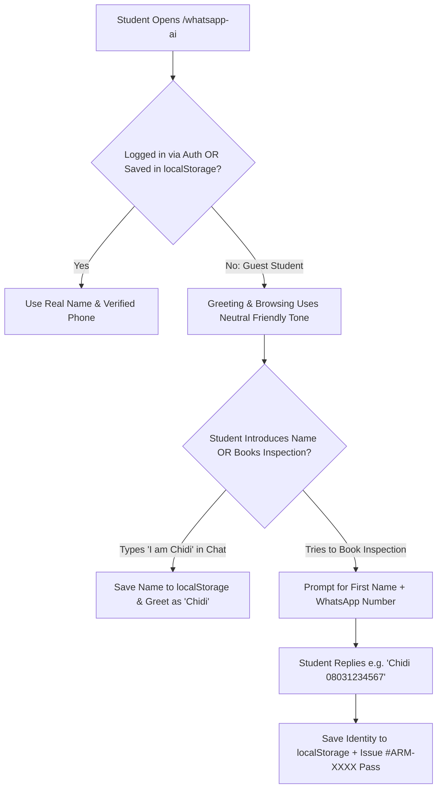

# Engineering Plan: Resolving Hardcoded "Amara" Identity for Real Users on WhatsApp AI

**Date:** October 29, 2026  
**Target Modules:**
- [`aroom-web/src/features/marketplace/pages/WhatsAppConciergePage.tsx`](file:///c:/Users/DELL/Downloads/Aroom/aroom-web/src/features/marketplace/pages/WhatsAppConciergePage.tsx)
- [`aroom-web/src/lib/whatsappAiConcierge.ts`](file:///c:/Users/DELL/Downloads/Aroom/aroom-web/src/lib/whatsappAiConcierge.ts)
- [`supabase/functions/whatsapp-ai-webhook/index.ts`](file:///c:/Users/DELL/Downloads/Aroom/supabase/functions/whatsapp-ai-webhook/index.ts)

---

## 1. Problem Statement & Root Cause Analysis

Currently, any unauthenticated student who opens `/whatsapp-ai` and chats with the Aroom Housing Assistant is addressed as **"Amara"** and assigned a hardcoded phone number (`+2348055556666`).

### Exact Locations Causing the Issue

1. **[`WhatsAppConciergePage.tsx` (Lines 137–138)](file:///c:/Users/DELL/Downloads/Aroom/aroom-web/src/features/marketplace/pages/WhatsAppConciergePage.tsx#L137-L138):**
   ```ts
   studentName: session?.fullName || 'Amara Chukwuemeka',
   studentPhone: session?.phoneNumber || '+2348055556666',
   ```
   When `session` is `null` (which is true for most first-time student visitors), the page passes `'Amara Chukwuemeka'` and `'+2348055556666'` into `processWhatsAppStudentMessage()`.

2. **[`whatsappAiConcierge.ts` (Lines 499–500)](file:///c:/Users/DELL/Downloads/Aroom/aroom-web/src/lib/whatsappAiConcierge.ts#L499-L500):**
   ```ts
   const studentPhone = input.studentPhone || '+2348055556666'
   const studentName = input.studentName || 'Amara Chukwuemeka'
   ```
   - Extracts `firstName = studentName.split(' ')[0]` $\rightarrow$ `'Amara'`.
   - Every bot response (`"Sure thing, Amara!"`, `"Great question, Amara!"`) addresses the user as Amara.
   - **Critical Side Effect:** Because `+2348055556666` is a valid 11-digit Nigerian phone number, `isValidNigerianPhone(studentPhone)` evaluates to `true`, bypassing the Mandatory Phone Gate (Task 2.3) and logging bookings under Amara's fake phone number.

3. **[`whatsappAiConcierge.ts` (`INITIAL_BOOKINGS`)](file:///c:/Users/DELL/Downloads/Aroom/aroom-web/src/lib/whatsappAiConcierge.ts#L123-L142):**
   - Seeds `localStorage` with a hardcoded booking (`#ARM-4821` for `Amara Nwosu`) so every visitor sees someone else's inspection pass in their personal **Scheduled Free Inspections** drawer.

---

## 2. Architecture & User Experience Plan

Real students visiting `/whatsapp-ai` should never be called by someone else's name, nor should they be forced into a heavy sign-up wall before they can ask about room prices.

We will solve this using a **5-Step Progressive Identity Architecture**:



---

### Step 1: Remove All Hardcoded `"Amara"` & Fake Phone Fallbacks

1. **Create a Persistent Student Identity Store Helper (`whatsappAiConcierge.ts`):**
   Store and retrieve the visitor's real name and phone number in `localStorage` (`aroom_student_name` and `aroom_student_phone`), falling back to `getCurrentSession()` if logged in, or `''` if unknown:
   ```ts
   export interface StudentChatIdentity {
     name: string
     phone: string
   }

   export function getStudentChatIdentity(session?: { fullName?: string; phoneNumber?: string } | null): StudentChatIdentity {
     const storedName = typeof localStorage !== 'undefined' ? localStorage.getItem('aroom_student_name') || '' : ''
     const storedPhone = typeof localStorage !== 'undefined' ? localStorage.getItem('aroom_student_phone') || '' : ''
     return {
       name: (session?.fullName || storedName).trim(),
       phone: (session?.phoneNumber || storedPhone).trim(),
     }
   }

   export function saveStudentChatIdentity(patch: Partial<StudentChatIdentity>) {
     if (typeof localStorage === 'undefined') return
     if (patch.name !== undefined) localStorage.setItem('aroom_student_name', patch.name.trim())
     if (patch.phone !== undefined) localStorage.setItem('aroom_student_phone', patch.phone.trim())
   }
   ```

2. **Neutral Greeting Helper (When Name is Unknown):**
   Instead of `const firstName = studentName.split(' ')[0]` (which produced `'Amara'`), use a helper that formats natural phrasing with or without a name:
   ```ts
   function getFirstName(fullName?: string): string {
     const clean = (fullName || '').trim()
     if (!clean || clean.toLowerCase() === 'guest' || clean.toLowerCase() === 'student') return ''
     return clean.split(/\s+/)[0]
   }
   ```
   - **When name is known (`"Chidi"`):** `"Hi Chidi! 👋"`, `"Sure thing, Chidi!"`
   - **When name is unknown (`""`):** `"Hi there! 👋"`, `"Sure thing! Here is the complete cost breakdown..."`

---

### Step 2: Passive & Conversational Name + Phone Extraction

1. **Natural Name Detection in Chat:**
   If a student writes *"My name is Chidi"*, *"I'm Kemi"*, or *"Na Tunde be my name"*, automatically extract the name and save it via `saveStudentChatIdentity({ name })`.

2. **Combined Name + Phone Gate During Inspection Booking:**
   When an anonymous student asks to book an inspection (e.g., *"Book David tomorrow at 2pm"*) and either their **name** or **valid Nigerian WhatsApp number** is missing:
   - Hold the booking draft in `aroom_pending_booking_draft`.
   - Reply:
     > *"Almost done! 👋 Please reply with your **First Name and active WhatsApp number** (e.g., `Chidi 08031234567`) so we can issue your free **#ARM-XXXX** inspection pass and send it to your phone."*
   - When the student replies with `"Chidi 08031234567"` (or just `"08031234567"` if their name was already provided):
     - Extract the 11-digit Nigerian number (`08031234567`).
     - Extract the name token (`Chidi`), or if they only typed a phone number, ask for their name or label the pass with their phone number until named.
     - Persist both to `localStorage` and immediately generate the `#ARM-XXXX` inspection pass under their real name and phone number!

---

### Step 3: Interactive Identity Pill in the Chat Header (`WhatsAppConciergePage.tsx`)

Add a sleek, non-intrusive identity badge in the top WhatsApp bar on [`WhatsAppConciergePage.tsx`](file:///c:/Users/DELL/Downloads/Aroom/aroom-web/src/features/marketplace/pages/WhatsAppConciergePage.tsx):

- **If Guest (Not yet identified):**
  Renders a button pill: **`👤 Chatting as Guest • Set Name & WhatsApp`**
- **If Identified (`Chidi • 08031234567`):**
  Renders: **`👤 Chidi (08031234567) ✎`**
- Clicking the pill opens a compact inline popover/bar where the user can set or clear their Name and WhatsApp number at any time (helpful for real students and for demos/testing multiple students).

---

### Step 4: Scope Bookings Drawer to the Current User

1. **Stop Showing Amara's Seed Booking to New Students:**
   - Remove `Amara Nwosu` from the student-facing drawer default or filter `bookings` on `/whatsapp-ai` so a student only sees bookings created on their device or matching their `studentPhone`.
   - Keep seed bookings available only for the **Team Leader Console** demo view if needed, or start with a clean state.
2. **Friendly Empty State in the Bookings Drawer:**
   When a student has `0` bookings, display:
   > *"No inspections booked yet. Ask the assistant in chat or tap **Book Free Inspection** under any verified agent to get your `#ARM-XXXX` pass."*

---

### Step 5: Real Twilio WhatsApp Webhook Cleanup (`whatsapp-ai-webhook/index.ts`)

On actual WhatsApp (via Twilio), Twilio's webhook payload always includes:
- `From`: `whatsapp:+234803XXXXXXX` (the student's real WhatsApp phone number)
- `ProfileName`: The student's actual WhatsApp display name

**Changes in [`supabase/functions/whatsapp-ai-webhook/index.ts`](file:///c:/Users/DELL/Downloads/Aroom/supabase/functions/whatsapp-ai-webhook/index.ts):**
- Remove all `'+2348055556666'` fallbacks on lines 245, 255, 260, 276, and 283; replace with `''`.
- Use `ProfileName` from Twilio when available, or `payload.studentName` from the web simulator, defaulting to `''` (neutral greeting) if blank.

---

## 3. Summary of Files to Modify

| File | Changes to Make |
|---|---|
| [`aroom-web/src/lib/whatsappAiConcierge.ts`](file:///c:/Users/DELL/Downloads/Aroom/aroom-web/src/lib/whatsappAiConcierge.ts) | • Remove `'Amara Chukwuemeka'` and `'+2348055556666'` fallbacks.<br>• Add `getStudentChatIdentity()`, `saveStudentChatIdentity()`, and `extractNameAndPhone()`.<br>• Make bot greetings neutral when `firstName` is empty.<br>• Update Stage 4 Phone Gate to capture both Name + WhatsApp number.<br>• Remove Amara's hardcoded booking from student `INITIAL_BOOKINGS`. |
| [`aroom-web/src/features/marketplace/pages/WhatsAppConciergePage.tsx`](file:///c:/Users/DELL/Downloads/Aroom/aroom-web/src/features/marketplace/pages/WhatsAppConciergePage.tsx) | • Pass real `studentName` and `studentPhone` from `getStudentChatIdentity(session)` (no Amara fallback).<br>• Add interactive **Student Identity Pill** (`Set Name & WhatsApp` / `Edit`) in the header.<br>• Add clean empty state for the Scheduled Free Inspections drawer. |
| [`supabase/functions/whatsapp-ai-webhook/index.ts`](file:///c:/Users/DELL/Downloads/Aroom/supabase/functions/whatsapp-ai-webhook/index.ts) | • Remove `'+2348055556666'` fallbacks.<br>• Respect real Twilio `ProfileName` and `From` fields or neutral phrasing when anonymous. |

---

## 4. Verification & Acceptance Criteria

- [ ] **Test 1 (Fresh Anonymous Visit):** Opening `/whatsapp-ai` in a fresh browser greets the user with *"Hi there! 👋 Welcome to Aroom Housing Assistant"* and never mentions `"Amara"` in any reply.
- [ ] **Test 2 (Asking Room Prices as Guest):** Asking *"Show me rooms in Choba under 250k"* or *"What is the full cost for #1?"* replies with natural neutral phrasing (*"Sure thing! Here is the complete, transparent cost breakdown..."*) without calling the user Amara.
- [ ] **Test 3 (Booking Gate Captures Real Name & Phone):** Clicking *"Book David for tomorrow at 2pm"* as a guest prompts for First Name + WhatsApp number. Replying `"Kelechi 08031234567"` generates pass `#ARM-XXXX` under **Kelechi (`08031234567`)** and addresses the user as **Kelechi** from that point on.
- [ ] **Test 4 (Header Identity Switcher):** Clicking the student identity pill in the header allows setting or changing the active student name and phone number at any time.
- [ ] **Test 5 (Logged-in Student):** If a student is logged in via `pilotAuthStore`, their account name and phone number are used automatically.
